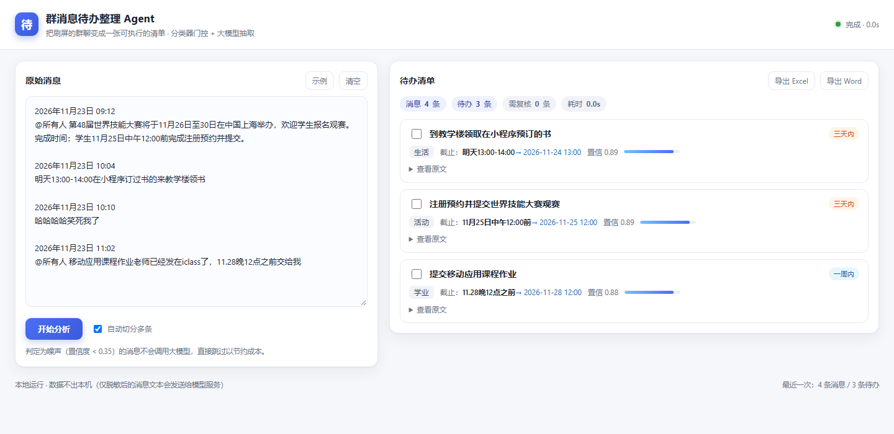

# 群消息待办整理 Agent

把刷屏的校园群聊整理成一张可执行的清单：**本地分类器判断「是不是待办」→ 大模型抽取「要做什么、什么时候截止」→ 时间归一化与过期判定 → 导出 Excel / Word**。



课程：《机器学习》期末项目 · 个人完成

---

## 1. 它解决什么问题

学生群每天几十上百条消息，作业、材料、缴费、开会通知和闲聊、表情包、游戏战报混在一起。人工翻记录的成本高、漏 DDL 的代价大。
本 Agent 的输入是一段（或多条）群消息，输出是结构化待办清单：事项、原文时间、归一化截止时间、分类、置信度、是否需要人工确认。

**成功标准**（可量化）：在 60 条人工标注的测试消息上，待办检测 F1、截止时间抽取准确率、单条处理成本与延迟。

## 2. 快速开始

```bat
:: 方式一：双击
启动.bat

:: 方式二：命令行
python -m venv .venv
.venv\Scripts\pip install -r requirements.txt
copy .env.example .env      :: 填入 LLM_API_KEY
.venv\Scripts\python train.py
.venv\Scripts\python -m app.main
```

浏览器打开 <http://127.0.0.1:8000>，粘贴消息 → 点「开始分析」。

> 只想看界面不想调模型：先跑 `train.py`，页面中置信度低于 0.35 的消息不会调用大模型；但高于阈值时仍需 `LLM_API_KEY`。

## 3. 目录结构

```
msg2todo/
├─ 启动.bat              # 双击启动
├─ .env.example          # 密钥模板（真实 .env 不入库）
├─ requirements.txt
├─ core/                 # 与界面无关的核心逻辑
│  ├─ parse.py           # 聊天记录解析 + 脱敏（手机号/学号/昵称/链接）
│  ├─ rules.py           # 关键词规则基线
│  ├─ timeparse.py       # 中文时间表达归一化（明天/本周日/9.27/中午十二点…）
│  ├─ llm.py             # DeepSeek 调用：重试、磁盘缓存、并发、token 统计
│  └─ pipeline.py        # 分类器门控 → 大模型抽取 → 校验 → 过期分组
├─ app/
│  ├─ main.py            # 标准库 http.server（3 个接口 + 静态文件）
│  └─ static/            # 单页前端（原生 HTML/CSS/JS，无构建）
├─ models/               # clf.pkl（待办分类器）、cat.pkl（类别模型）
├─ data/                 # messages.jsonl / labels.jsonl / split.json；raw/ 为原始记录（不入库）
├─ results/              # 实验指标、图表、错误分析、缓存
├─ train.py              # 训练 + 交叉验证 + 跨群测试 + 规则基线
├─ cli.py                # 批量实验 / 单条分析 / 数据统计
├─ prepare_data.py       # 金标准固化与数据划分
├─ label.py              # 大模型按规范预标注（结果经人工复核）
├─ ablation_features.py  # 特征表示消融（word vs char vs char_wb）
├─ analyze_results.py    # 出图 + 错误案例
└─ tests/test_basic.py   # 20 项离线自检（不调用模型）
```

## 4. 复现实验

```bat
.venv\Scripts\python core\parse.py           :: 解析 + 脱敏 → data/messages.jsonl
.venv\Scripts\python label.py                :: 预标注（需 API，可用缓存）
.venv\Scripts\python prepare_data.py         :: 人工复核固化 + 数据划分
.venv\Scripts\python train.py                :: 分类器指标 → results/clf_metrics.json
.venv\Scripts\python cli.py experiment       :: 5 组对照 → results/experiment.json
.venv\Scripts\python ablation_features.py    :: 特征消融
.venv\Scripts\python analyze_results.py      :: 图表与错误分析
.venv\Scripts\python tests\test_basic.py     :: 自检
```

## 5. 主要结果（60 条测试集，16 条待办）

| 方案 | 精确率 | 召回率 | F1 | 成本(元) |
|---|---|---|---|---|
| A 关键词规则 | 0.786 | 0.688 | 0.733 | 0 |
| B 纯大模型零样本 | 0.765 | 0.812 | 0.788 | 0.034 |
| C 规则门控+大模型 | 0.750 | 0.562 | 0.643 | 0.009 |
| **D 分类器门控+大模型（本方案）** | **0.867** | **0.812** | **0.839** | **0.014** |
| E 消融：去掉分类器门控 | 0.765 | 0.812 | 0.788 | 0.034 |

分类器本体（离线、CPU）：随机分层测试集 F1 0.889 / AUC 0.965；跨群测试 F1 0.538（域偏移明显，详见课程提交的报告 PDF）。

## 6. 数据与隐私

- 数据来自本人所在三个微信群各 100 条，共 300 条；已在解析阶段脱敏：昵称→`[成员N]`、群名→`[群N]`、手机号→`[手机号]`、学号→`[学号]`、长链接→`[链接]`、微信附件文件名→删除。
- `data/raw/` 含原始记录，已在 `.gitignore` 中排除，不随仓库发布。
- 仅脱敏后的消息正文会发送给模型服务；密钥只从环境变量读取，不写入任何文件。

## 7. 复用组件

| 组件 | 版本 | 许可证 | 用途 |
|---|---|---|---|
| Python | 3.12.14 | PSF-2.0 | 运行时 |
| scikit-learn | 1.9.1 | BSD-3-Clause | TF-IDF 与逻辑回归 |
| numpy | 2.3.5 | BSD-3-Clause | 数值计算 |
| joblib | 1.6.0 | BSD-3-Clause | 模型序列化 |
| openpyxl | 3.1.5 | MIT | Excel 导出 |
| python-docx | 1.2.0 | MIT | Word 导出 |
| matplotlib | 3.11.2 | PSF-based (BSD 兼容) | 图表 |
| DeepSeek API | deepseek-chat | 服务条款 | 待办字段抽取 |

详见课程提交的报告 PDF 中「Skills 与组件复用」一节（含对 TfidfVectorizer 的行为核验与适配实验）。

## 8. 已知局限

- 300 条、单人标注，正例仅 83 条，指标方差大；类别模型（学业/事务/活动/生活）准确率仅 0.56，只用于界面展示。
- 跨群泛化明显下降（F1 0.889 → 0.538），说明模型仍部分依赖“群的语言风格”。
- 时间解析是规则实现，"晚上12点" 这类歧义表达会被解析为 12:00，属已知不足。

## 9. 常见问题

**页面显示「Failed to fetch」或右上角红点「服务未连接」**
说明浏览器里的页面还在，但后台的 Python 进程已经退出（关掉了启动窗口、或电脑重启过）。
页面只是外壳，分析逻辑全在后台进程里，所以必须重新启动：

```bat
启动.bat
```

看到「服务已启动：http://127.0.0.1:8000」后，回到浏览器按 F5 刷新即可。
注意：`启动.bat` 的那个命令行窗口必须一直开着，关掉它服务就停了。

**端口被占用（address already in use）**
说明已有一个实例在跑，直接打开 http://127.0.0.1:8000 即可；或换端口：
`.venv\Scripts\python -m app.main --port 8010`（需同步修改 app/main.py 中的 PORT，或用环境变量）。

**分析很慢**
每条消息约 0.5–3 秒，取决于模型服务的响应速度；一次粘贴 10 条会并发处理，
总耗时约为 2–4 秒 + 单条时间。首次调用还需加载模型，会多 1–2 秒。
